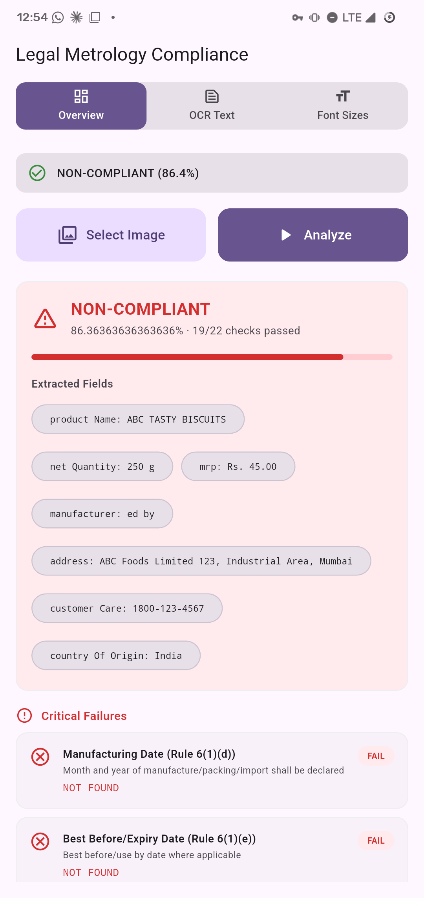
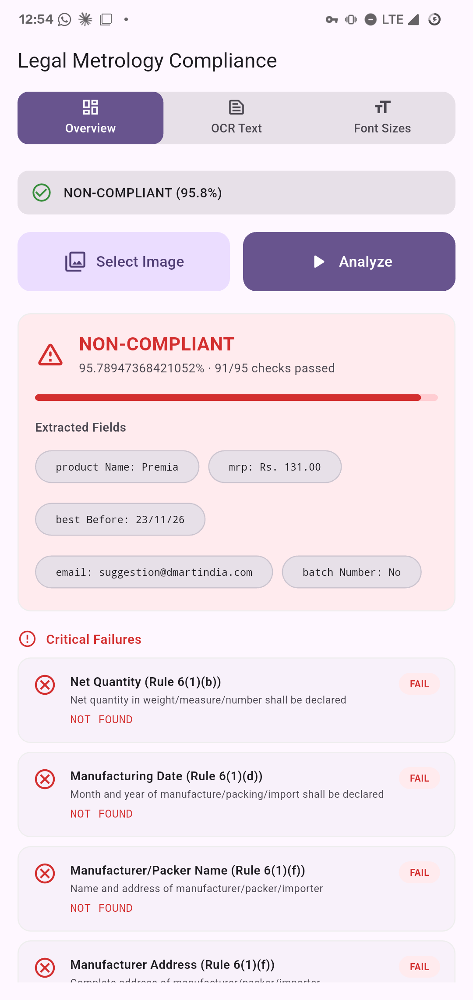
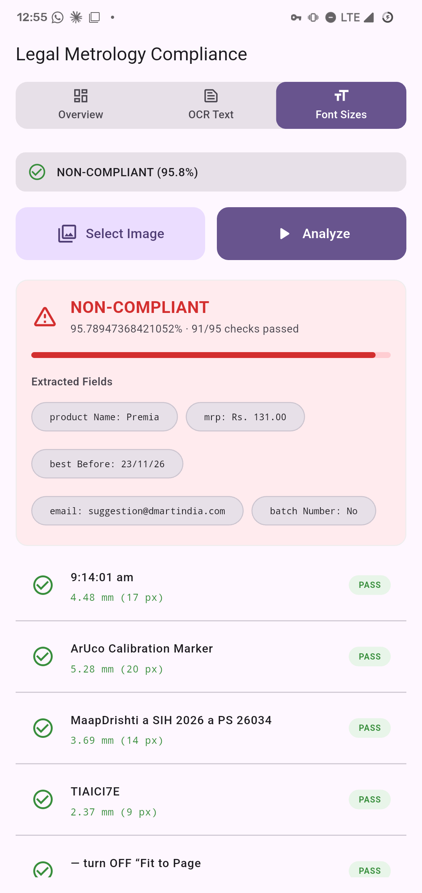

# MaapDrishti

**Point your phone at a packaged product. MaapDrishti reads the label, measures the print and checks it against Legal Metrology rules.**

[](https://github.com/ayyogz/maapdrishti/actions/workflows/build.yml)


Built for **Smart India Hackathon 2026 · Problem Statement 26034**. Working prototype.

<p align="center">
  
  
  
</p>

## What it does

1. You **photograph a product label** (or pick a photo) with a printed **ArUco calibration marker** placed next to it.
2. **PaddleOCR** reads every line of text on the label, with its position, on the phone.
3. **OpenCV** finds the marker, which gives the real-world size of one pixel in millimetres.
4. The **compliance engine** pulls out the declarations on the pack and checks them against the *Legal Metrology (Packaged Commodities) Rules, 2011*. It also measures the height of the printed text against the minimum (1 mm by default).
5. The app shows a **verdict** with three tabs: **Overview** (the extracted fields and each check), **OCR Text** and **Font Sizes**.

Fields it looks for: product name, net quantity, MRP, manufacturing date, best before, manufacturer, address, phone, email, customer care, country of origin and batch number.

No marker in the photo? The declaration checks still run. Only the font-size checks are skipped, because they need the calibration.

## Install

**Just want to try it?**

1. Open the [latest release](../../releases/latest).
2. Download **`app-arm64-v8a-release.apk`**. This is the right one for almost every phone made in the last 8 years.
3. On your phone, allow **Install unknown apps** for your browser or file manager, then open the APK.

Requires Android 8.0 (API 26) or newer. This is a prototype signed with a debug key, so Android may show a warning.

## Try it without printing a marker

The `test_images/` folder has ready-made samples. Copy **`test_label_aruco.jpg`** to your phone (USB, Bluetooth, or message it to yourself) so it appears in the gallery, then pick it in the app.

To use a real pack, print **`test_images/aruco_4x4_50_id23.png`** at the real-world size that `ArUcoDetector.kt` expects, and place it flat next to the label in the same plane. `test_images/create_marker.py` regenerates marker images (run it from inside `test_images/` after `pip install -r requirements.txt`).

## Build from source

You need **Flutter** (stable channel, Dart ≥ 3.13.1), **JDK 21** and the **Android SDK**. The OCR models and the SDK library are already in the repo. OpenCV and ONNX Runtime download from Maven Central on the first build.

```bash
git clone https://github.com/ayyogz/maapdrishti.git
cd maapdrishti
flutter pub get

flutter run                                  # on a connected phone
flutter build apk --release --split-per-abi  # APKs land in build/app/outputs/flutter-apk/
```

Run `flutter doctor` first if anything complains. If Gradle fails with a `jlink` or `jdkImage` error, your JDK is too new for the Android Gradle Plugin, so point `JAVA_HOME` at JDK 21. Every `v*` tag also builds the APKs automatically with GitHub Actions (`.github/workflows/build.yml`).

## How it works

```
photo ─► Flutter UI (lib/main.dart)
          │  MethodChannel  com.sih.legmet/paddleocr
          ▼
      MainActivity.kt
        ├─ recognize        PaddleOCR detection + recognition (ONNX Runtime) ─► text lines + boxes
        ├─ detectAruco      OpenCV ArUco marker (ArUcoDetector.kt)           ─► mm per pixel
        └─ checkCompliance  ComplianceEngine.kt                              ─► fields, checks, verdict
```

- **Reading order matters.** The engine sorts OCR boxes top to bottom, then left to right, and matches each label to its value within a single line. That avoids matching across unrelated lines.
- **Calibration.** Pixel height divided by the marker's measured pixel size gives millimetres. The minimum text height becomes a pixel threshold for the photo.
- A flowchart of the full system is in [`docs/architecture_flowchart.html`](docs/architecture_flowchart.html) (download it and open it in a browser), and the pitch slide is [`docs/slide5-impact.html`](docs/slide5-impact.html).

## Project structure

```
lib/main.dart                         Flutter UI: scan, verdict, Overview / OCR Text / Font Sizes tabs
android/app/src/main/kotlin/.../
  MainActivity.kt                     MethodChannel handlers: initialize, recognize, detectAruco, checkCompliance
  ComplianceEngine.kt                 Field extraction and Legal Metrology checks
  ArUcoDetector.kt                    Marker detection and pixel-to-mm calibration
  PaddleOCRApplication.kt             Application class
android/app/src/main/assets/models/   PaddleOCR detection and recognition models (ONNX)
android/app/libs/                     Local ppocr-sdk AAR
test_images/                          Sample labels, ArUco markers and the scripts that make them
docs/                                 Flowchart, pitch slide and screenshots
```

## Tech stack

Flutter · Dart · Kotlin · PaddleOCR (PP-OCRv6) · ONNX Runtime for Android 1.21.1 · OpenCV 4.14.0

## Limitations

- A prototype, not legal advice and not an official compliance certificate.
- It applies one minimum print height (1 mm by default) to every pack.
- Fields are found with regular expressions, so unusual label wording or layouts can be missed.
- Results depend on photo quality: glare, blur and curved packs hurt OCR, and the marker must lie flat in the same plane as the label.

## Team

**[Team name]** · [member 1] · [member 2] · [member 3]

## Credits and license

- OCR models come from [PaddleOCR](https://github.com/PaddlePaddle/PaddleOCR) (Apache-2.0), exported to ONNX. The recognition model is `PP-OCRv6_tiny_rec`.
- [ONNX Runtime](https://onnxruntime.ai/) and [OpenCV](https://opencv.org/) do the on-device inference and marker detection.
- Code license: **[choose one, e.g. MIT]**.
